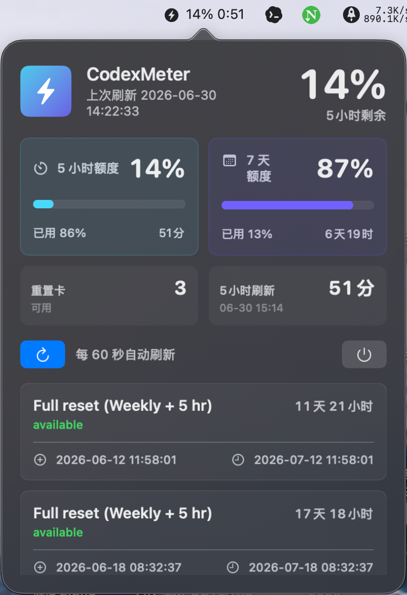

# CodexMeter

一个本地 macOS 菜单栏小应用，用本机 Codex 凭证实时显示 reset credits 额度和到期时间。平时只占用菜单栏一个小位置，点击后展开毛玻璃信息面板。

## 功能

- 从 `~/.codex/auth.json` 读取 `tokens.access_token`
- 请求 `https://chatgpt.com/backend-api/wham/rate-limit-reset-credits`
- 请求 `https://chatgpt.com/backend-api/wham/usage`
- 菜单栏显示 5 小时窗口剩余额度和刷新倒计时
- 弹窗展示 5 小时与 7 天窗口的剩余额度、已用比例、重置时间
- 弹窗展示每张 credit 的 `status`、`title`、`granted_at`、`expires_at`
- 所有时间按上海时间显示
- 自动按系统语言显示：中文系统为中文，其他系统为纯英文
- 每 60 秒自动刷新，支持手动刷新
- 401 时显示“凭证失效或没带对 Authorization header”
- 右键菜单支持刷新和退出
